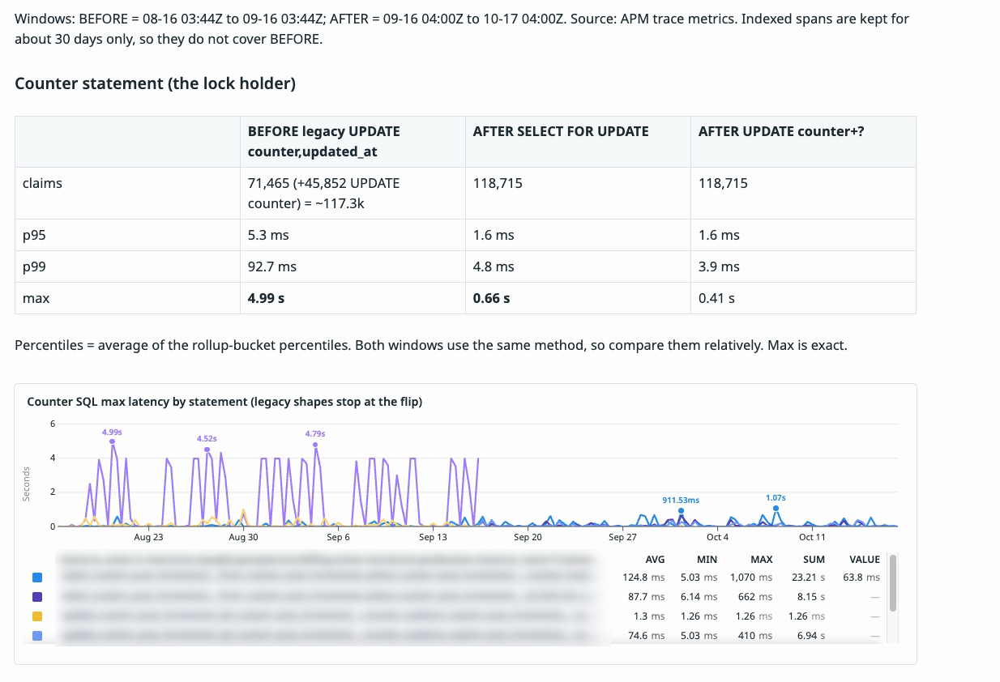
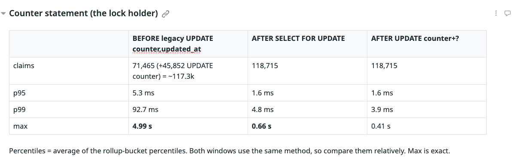
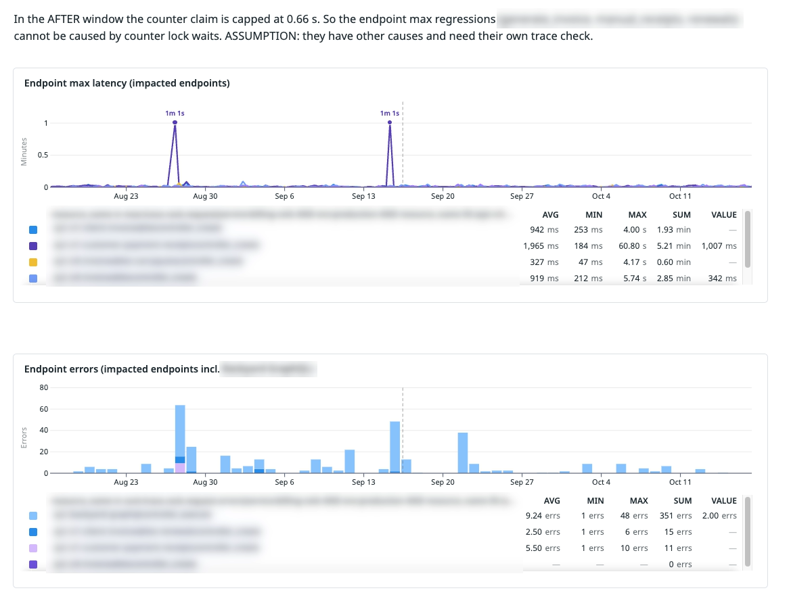
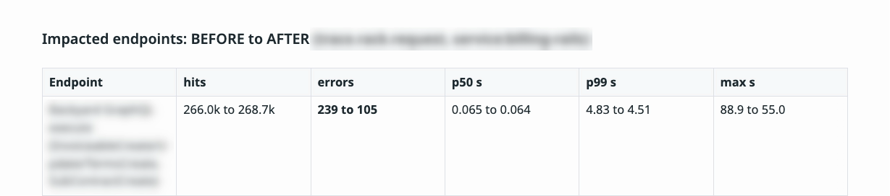

In my [last post](/blog/the-one-row-that-blocked-every-invoice/), I wrote about one database row that blocked every invoice. Every new invoice number came from a shared counter row. That row stayed locked for the whole request, so busy moments turned into a queue, and the queue turned into timeouts.

A fix that works on my laptop is a promise. A fix that works in production is a result

## What we actually shipped

The first post showed a version built on `LAST_INSERT_ID`. The version that went to production is simpler. We kept the library's (protokoll - library installed on repo by legacy :() own logic and changed only two things: the connection and the lock.

```ruby
def claim(object, options)
  Row.transaction do                     # Row uses its own connection pool
    row = Row.find_or_create_by(build_attrs(object, options))
    row.lock!                            # SELECT ... FOR UPDATE
    row.counter = options[:start].to_i if outdated?(row, options) || row.counter.to_i.zero?
    row.increment!(:counter, touch: true)
    row.counter
  end
end
```

`Row` points at the same database, but through a separate connection pool. So this small transaction commits on its own, in a few milliseconds. The caller's long transaction never holds the counter lock.

`lock!` runs `SELECT ... FOR UPDATE`. It makes two requests take turns on the row, so they can't both read the same value. Before, the long transaction did this job by accident. Now the short transaction does it on purpose.

The whole path sits behind an environment toggle. We turned it on in production on 16 September 2026 at 10:44 local time.

## How I measured it

I compared two 30-day windows, one before the switch and one after. Both had almost the same traffic, about 118 thousand counter claims each month. That matters, because a quiet month can make any change look good.

The numbers come from APM trace metrics in Datadog. APM means application performance monitoring, a tool that records how long each request and each database query takes. I used the metrics and not the raw traces, because raw traces are kept for only about 30 days. They didn't cover the "before" window.

One honest note about the percentiles. They are an average of the percentile in each time bucket. That is not a perfect p99, but both windows use the same method. So the comparison between them is fair, even if the absolute value is a bit off. The max values are exact.

## The counter query: from seconds to milliseconds

The first place to look is the counter query itself. This is the statement that used to hold the lock.



Look at the purple spikes on the left. Again and again, they reach about 4 to 5 seconds, then they stop at the toggle line. In the earlier post, my test request failed with a lock timeout at 5.1 seconds. Production was hitting the same wall many times a week.



| Counter query | Before | After | Change |
| --- | --- | --- | --- |
| Claims in 30 days | ~117.3k | 118.7k | about the same |
| p95 | 5.3 ms | 1.6 ms | 70% lower |
| p99 | 92.7 ms | 4.8 ms | 94.8% lower |
| Max (worst wait) | 4.99 s | 0.66 s | 86.8% lower |

The worst case is the number I care about most. A request that waits 5 seconds for a counter is a request that is close to failing. Now the worst wait is under a second.

## The endpoints: faster worst cases, fewer errors

A faster query is nice, but users don't call queries. They call endpoints. So I checked the endpoints that create invoices, receipts and contracts.



| Endpoint | Worst case before | Worst case after | Change |
| --- | --- | --- | --- |
| Create invoice (main API) | 5.74 s | 3.09 s | 46.2% lower |
| Carry quota (the original incident) | 4.17 s | 2.33 s | 44.1% lower |
| Payment receipt callback | 60.8 s | 2.33 s | 96.2% lower |

The payment receipt number needs care. The 60.8 seconds comes from a single bad request in the "before" window. So read it as "the worst outlier is gone", not as "receipts are 26 times faster".

Errors also dropped on the endpoints that had them:



| Endpoint | Errors before | Errors after |
| --- | --- | --- |
| GraphQL Query (manual invoices, contracts) | 239 | 105 |
| Subscription renewals | 15 | 0 |
| Payment receipt callback | 11 | 0 |

I think most of these were lock wait timeouts. But I couldn't prove it, because the logs that would show the error type weren't reachable when I did this analysis. So I only claim that errors went down, not why every single one disappeared.

## The number that didn't move

Here is the part that surprised some people. The median latency (p50) of these endpoints didn't change at all. The main create endpoint was 36 ms before and 36 ms after.

That makes sense once you think about it. On a quiet request, nobody else is holding the counter, so there was never a queue. The fix only helps when two requests arrive together. That is exactly when users used to get errors.

So if you only watch averages, you'll think this change did nothing. You have to look at the tail: the max, the p99 and the error count.

## Not every graph went down

A few endpoints got a worse worst case in the "after" window. One went from 4.99 s to 12.0 s.

I checked whether the counter could be the cause. In the "after" window, the counter query never took more than 0.66 s. So it can't explain a 12 second request. Something else is slow there, and it needs its own investigation.

I'm mentioning this on purpose. A before and after report that only shows the green arrows is hard to trust.

## The small cost we pay

Nothing is free. The counter now uses a second connection pool, so there are a few more connections to the database. The lookup query on the counter table also went from about 1.1 ms to 2.2 ms at the median.

There is also the trade-off from the first post. The claim commits on its own, so a failed request still uses up a number. The sequence can have gaps. We had gaps before too, because a request that failed validation also used up a number. But it is worth saying clearly to anyone who reads those numbers.

## What I'd tell a team with the same pattern

If your service makes sequential numbers (invoice numbers, order numbers, ticket ids) from one shared counter row, check where that update runs. If it runs inside a long transaction, the lock lives as long as that transaction. Under load, that one row becomes a queue for the whole system.

You don't need a big redesign. Claim the number on its own short transaction
